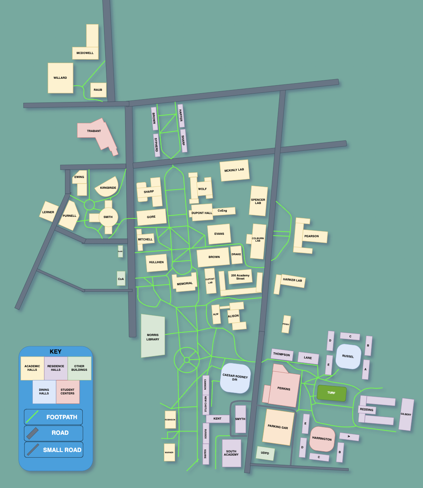

# U-Go

This project was created for Henhacks Spring 2023, a one day hackathon hosted by the University of Delaware. U-GO was created to precise students with a more detailed GPS system which would help with navigating halls and buildings on the university's campus. The difference between mainstream GPS applications such as Google Maps, U-GO offers specific routes that other GPS systems may overlook. 

Additionally, our future additions would include implementing full interiors of every building, facilitating easy navigation to room numbers. This project also secured first place in its category, earning a prize pool of $1,600, triumphing over 30 other competing teams.

## Authors

- [@RiceViz](https://www.github.com/RiceViz)
- [@OneTachi](https://www.github.com/OneTachi)
- [@CarterMcCabe](https://www.github.com/CarterMcCabe)

## Features

- GPS System Using Dijstra's Algorithm
- Java Gradle Application With FXML User-Interface
- Intuitive Map Design

## Screenshots

